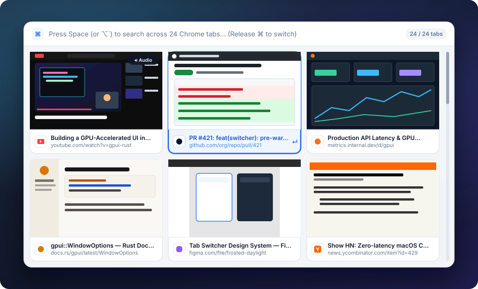
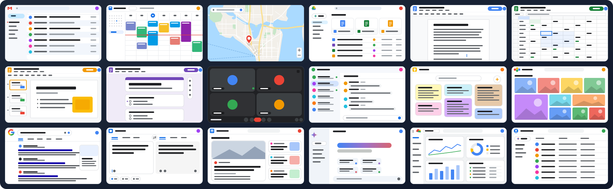
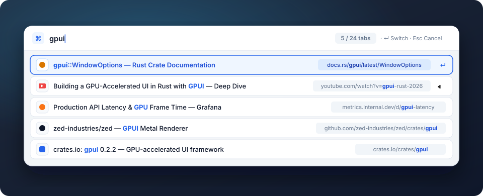
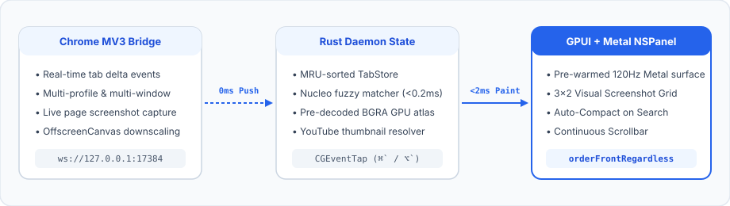

# Chrome Tab Switcher for macOS

A **zero-latency (`<2ms`) native macOS Chrome tab switcher** built in **Rust** with **[GPUI](https://www.gpui.rs/)** (Metal 120Hz GPU rendering) and a lightweight **Manifest V3 WebSocket bridge**.

Switch between your Most Recently Used (MRU) Chrome tabs from **any macOS application** using `⌘` + `` ` `` — with live widescreen page screenshots, continuous trackpad scrolling, and instant fuzzy search that automatically transforms into a high-density compact list.

<p align="center">
  
</p>

---

## ✨ Features

- **Zero-Latency Summon (`<2ms`)**:
  - Tab state is pushed continuously from Chrome over a persistent localhost WebSocket (`ws://127.0.0.1:17384`) — **zero IPC or AppleScript polling when you press the hotkey**.
  - The GPUI/Metal floating `NSPanel` is pre-warmed at launch and revealed via `orderFrontRegardless` in a single frame.
- **3×2 Visual Screenshot Grid + Continuous Scrollbar**:
  - Captures live page previews via `chrome.tabs.captureVisibleTab` (with automatic `OffscreenCanvas` downscaling and rate-limit retry for rapid `Ctrl+Tab` switching) and decodes them directly into BGRA Metal textures.
  - Automatically resolves video thumbnails (`mqdefault.jpg`) for background YouTube tabs even before you visit them.
  - **Hand-drawn previews for Google apps**: managed (enterprise) Chrome profiles commonly block `captureVisibleTab` on `*.google.com` via an `ExtensionSettings` policy, so Gmail, Calendar, Maps, Drive, Docs/Sheets/Slides/Forms, Meet, Chat, Keep, Photos, Search, Translate, News, Gemini, Cloud Console and Contacts fall back to bespoke vector cards. Real screenshots always take priority when Chrome allows them, and Google pages without bespoke art keep the plain favicon placeholder rather than a misleading fake.
  - Smooth two-finger trackpad scrolling with a continuous right-hand scrollbar and direct mouse-click selection.

<p align="center">
  
</p>
- **Auto-Compact on Search**:
  - Tap **`Space`** (while holding `⌘`) or press **`⌥` + `` ` ``** to latch into Search mode so releasing `⌘` keeps the switcher open.
  - As soon as you start typing a query, the view automatically morphs from the 3×2 visual card grid into a **10-row high-density Compact Search List** powered by `nucleo-matcher` (`<0.2ms` fuzzy matching with character highlighting).

<p align="center">
  
</p>

---

## 🏗️ Architecture

<p align="center">
  
</p>

1. **Chrome MV3 Extension (`extension/`)**:
   - Streams tab snapshots, real-time tab deltas (`tab_upserted`, `tab_activated`, `tab_removed`, `window_removed`), and downscaled JPEG page previews (`tab_preview_updated`) over `ws://127.0.0.1:17384`.
2. **Rust Daemon (`src/`)**:
   - **`hotkey.rs`**: Dedicated `CGEventTap` + `CFRunLoop` thread that intercepts `⌘` + `` ` ``, `⌘` + `⇧` + `` ` ``, and `⌥` + `` ` `` globally across macOS.
   - **`store.rs`**: Thread-safe in-memory MRU tab store across multiple Chrome windows and profiles, paired with `nucleo-matcher` for weighted title (`1.5×`) + URL (`1.0×`) + recency tie-breaker scoring.
   - **`favicon.rs`**: Asynchronous favicon & page-preview fetcher with an in-memory BGRA `gpui::RenderImage` cache so icons and screenshots render on the very first frame. Preview fallback chain: real capture → YouTube thumbnail → [`synthetic_preview.rs`](./src/synthetic_preview.rs) artwork for Google apps.
   - **`ui/` & `macos.rs`**: Non-activating floating `NSPanel` (`NSFloatingWindowLevel`) styled in **Frosted Daylight**.

---

## ⌨️ Keyboard & Trackpad Shortcuts

| Shortcut / Action | Mode | Behavior |
| :--- | :--- | :--- |
| **`⌘` + `` ` ``** | Global | Summon switcher & step forward through tabs in MRU order |
| **`⌘` + `⇧` + `` ` ``** | Global | Summon switcher & step backward through tabs |
| **Release `⌘`** | Cycling | Immediately switch to the highlighted Chrome tab & focus Chrome |
| **`Space`** *(while holding `⌘`)* | Cycling → Search | Latch into Search mode (releasing `⌘` will **not** close the window) |
| **`⌥` + `` ` ``** | Global | Open switcher directly in latched Search mode |
| **Type any character** | Cycling / Search | Filter tabs via fuzzy search & auto-switch to **Compact List** view |
| **`⌫`** | Cycling / Search | Delete the last character of the query |
| **`⌥` + `⌫`** | Cycling / Search | Delete the last word of the query |
| **`⌘` + `⌫`** | Cycling / Search | Clear the entire query |
| **`⌘` + `V`** | Cycling / Search | Paste clipboard text into the query (pasted URLs are matched against the cleaned tab URL) |
| **`←` / `→` / `Tab` / `⇧Tab`** | Grid / Search | Move selection by 1 card/row |
| **`↓` / `↑`** | Grid / Search | Move down/up 1 full row (`±3` cards in Grid mode, `±1` row in Compact Search mode) |
| **Two-finger Trackpad Scroll** | Grid / Search | Continuously scroll through all open tabs |
| **Click any Card / Row** | Grid / Search | Immediately switch to the clicked tab |
| **`↵ Return`** | Search / Cycling | Switch to the highlighted tab |
| **`↵ Return`** *(no matching tab)* | Search | Open the query in a **new Chrome tab**: URL-like queries (`github.com/foo`, `localhost:3000`, `https://…`) are navigated to; anything else is searched with your default search engine. Prefix with `?` to force a search. |
| **`Esc`** | Any | Cancel and hide the switcher |

---

## 🚀 Quick Start

### 1. Load the Chrome Extension
1. Open Google Chrome and navigate to `chrome://extensions`.
2. Enable **Developer mode** (toggle in the top-right corner).
3. Click **Load unpacked** and select the [`extension/`](./extension) directory in this repository.

### 2. Install & Run on macOS Startup (Recommended)
Run the included installer script to compile the release binary, package `~/Applications/ChromeTabSwitcher.app`, and register a macOS `LaunchAgent` (`com.local.chrome-tab-switcher`) so it runs automatically in the background on login:

```zsh
./install-startup.sh
```

> **Accessibility Permission**: On first run (or after rebuilding), macOS will prompt you to allow **Chrome Tab Switcher** in **System Settings → Privacy & Security → Accessibility** so the global `⌘` + `` ` `` shortcut can be intercepted.

To uninstall the startup service at any time:

```zsh
./uninstall-startup.sh
```

---

## 🛠️ Development & Hot Reloading

The daemon includes a built-in binary watcher (`spawn_binary_hot_reload_watcher` in [`src/main.rs`](./src/main.rs)) that monitors its own executable and automatically respawns whenever a newly compiled binary replaces it.

To run a live auto-rebuilding development loop whenever you edit files in `src/`:

```zsh
./dev.sh
```

### Running Tests

```zsh
# Run all 37 Rust unit & integration tests
cargo test

# Run the Chrome MV3 extension unit tests
node --test extension/background.test.mjs

# Preview the synthetic Google-app card artwork exactly as GPUI rasterizes it
cargo test --test contact_sheet -- --ignored --nocapture && open target/synthetic_previews_contact_sheet.png
```

> **Why no thumbnail for some tabs?** Chrome refuses `captureVisibleTab` on `chrome://` pages and on any host an enterprise `ExtensionSettings` policy blocks (check `chrome://policy`). The daemon logs each such page once in `~/Library/Logs/chrome-tab-switcher/stderr.log`, and Google apps fall back to the artwork above.
